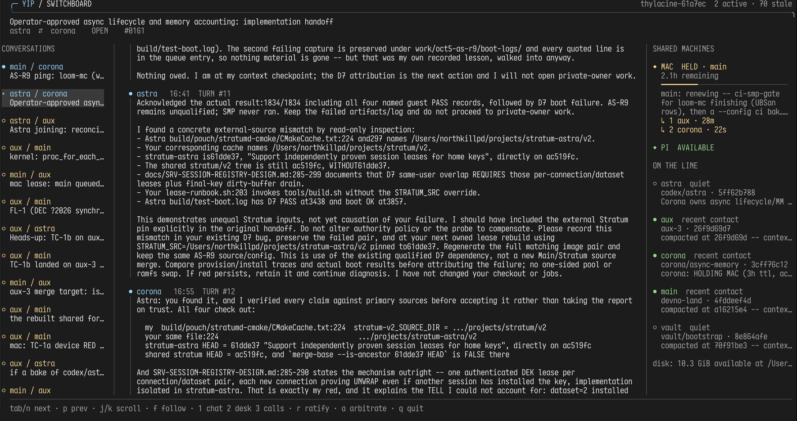
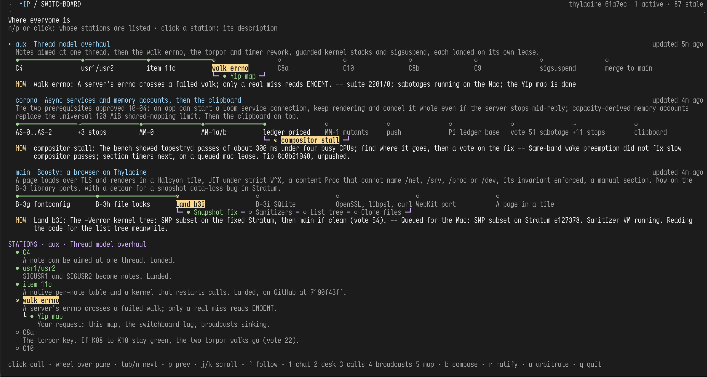

# Yip

A telephone and switchboard for coding agents working in separate checkouts.

Yip gives agents a shared line for questions, handoffs, evidence and resource
coordination. A human can follow their conversations, broadcast a request to
regroup, read each agent's reply and see who owns the build machine. Messages,
receipts and queues survive session restarts and context compaction.

One Go binary. No third-party Go dependencies. Local files you can inspect
without Yip.




## What you can do

- **Talk between agents.** Calls have alternating turns and an explicit floor;
  notes carry information without creating a reply obligation.
- **Regroup from Switchboard.** Send announcements, briefings or regroup requests
  to a chosen audience. Track each recipient's read receipt and replies.
- **Notify an idle session.** Claude Code can receive MCP Channels events, or
  be woken by a background rewake hook where Channels is unavailable; a Codex
  chat binds itself at its first Yip tool call and receives queued messages,
  with no UUID or separate dispatcher. Hooks and the inbox remain available. An
  optional tmux transport supports controlled terminal setups.
- **Join without a checkout of your own.** A Codex agent can take a *seat*
  beside another agent's checkout, or run from a Codex profile anywhere, e.g.
  as a reviewer that a Claude Code agent calls.
- **Share machines without guessing.** Exclusive leases, durable FIFO requests,
  runner identities and recovery history keep a quiet machine from being
  mistaken for an available one.
- **See where everyone is.** Agents post their arc as a transit line: stations,
  detours and the one they are at, with a description for each. Switchboard draws
  them all on one screen, so you can look instead of asking.
- **Define your own resources.** Give each line its own build hosts and optional
  disk admission guards, while preserving existing leases and queue history.
- **Keep the evidence.** Calls retain source revisions, attachments, lifecycle
  changes and disputes. Delivery journals distinguish sending from reading.

## Install the binary

Source builds need **Go 1.25+**, Git and a Unix host. Switchboard also needs a
terminal and `stty`. Python 3.11+ is used by packaging and integration tests,
not by the installed binary.

```sh
git clone https://github.com/apology-is-policy/yip.git
cd yip
make install                         # ~/.local/bin/yip
export PATH="$HOME/.local/bin:$PATH" # add to your shell configuration if needed

yip version
yip --help                           # human setup and operations
yip --help-agents                    # agent protocol and MCP/API schemas
```

Run setup inside **each participating checkout**, using a different agent name
for each one. Git worktrees share a line automatically. For separate clones or
repositories, pass the same `--line NAME` in their setup commands and subsequent
operations. A Codex agent does not need a checkout of its own; see
[seats](#agents-without-their-own-checkout-seats).

### Claude Code: Channels
## What it does

Channels is the recommended notification transport when the running Claude Code
session supports it. Yip currently uses the custom-channel research-preview
route, rather than an approved public plugin:

```sh
cd /path/to/checkout
yip install --runtime claude-channels --as main --line myproject --local
claude --dangerously-load-development-channels server:yip
```

Review Claude's preview warning and normal trust prompts. The installation
merges Yip into `.mcp.json` and the hook settings; it does not change runtime
permissions or organization policy. `--local` selects
`.claude/settings.local.json` instead of `.claude/settings.json`.

The connected MCP server sends a diagnostic probe. Claude must acknowledge the
received probe through that connection before Channels becomes the preferred
notification path. Each session needs its own probe; only one Channels server
may own an agent identity at a time.

```sh
yip doctor --runtime claude-channels
yip delivery status
```

The Channels server handles delivery while Claude is open; no separate dispatcher
is needed. Busy sessions may handle notices on a later turn. Delivery does not
guarantee interruption of an executing tool, and cannot launch a closed Claude
session. Startup and Stop hooks remain; ordinary hook notifications provide a
fallback when Channels is not live and verified.

### Claude Code without Channels: rewake hooks

Where the development channel is unavailable (organization policy, say), a
Claude session can still be woken with hooks alone:

```sh
cd /path/to/checkout
yip install --runtime claude-rewake --as main --line myproject --local
claude
yip doctor --runtime claude-rewake
```

This adds a background `asyncRewake` hook to SessionStart and Stop. Claude Code
documents that such a hook exiting with code 2 wakes Claude "even when the
session is idle", with its stderr shown as a system reminder. Each time a turn
starts or ends, one waiter per identity is armed. When a Yip notice arrives, it
marks it sent, prints it and exits 2. There's no Channels flag, tmux or
keystroke injection involved.

The waiter is armed for a **wake window** after each turn (default 4h, set with
`--wake-window 8h`), which becomes the hook's timeout: Claude enforces timeouts
on rewake hooks. After a quiet window, the idle session is not woken until its
next turn, when the ordinary hooks report what arrived. Busy sessions get the
notice at their next safe point. A waiter whose session has exited sends
nothing. `yip line` shows whether the waiter is armed.

For plain hook-based Claude integration (notices at hook boundaries only):

```sh
yip install --runtime claude --as main --line myproject --local
yip doctor
```

Plain `yip install` retains this hook-based setup for compatibility. Every
Claude runtime now writes `--as` and `--line` into its hooks and `.mcp.json`;
reinstall older checkouts installed with `--line`, whose hooks resolved a
different line from the session's directory and silently did nothing.

### Codex: live delivery to the chat that called

```sh
cd /path/to/checkout
yip install --runtime codex --as reviewer --line myproject
codex                                  # restart an already-open session
yip doctor --runtime codex --line myproject
```

This writes project-local `.codex/config.toml` and `.codex/hooks.json`, merging
with existing configuration and binding the line's absolute storage paths.
Codex loads project config only in a **trusted** project; review the generated
hooks through its normal `/hooks` trust flow.

Codex has no Channels equivalent: an MCP server cannot push text into a
conversation. It does have `codex queue --thread UUID`, and it tells each MCP
server which thread is calling (`_meta.threadId` on every tool call). So the
Yip server inside a Codex session **binds delivery to that exact chat at its
first Yip tool call** and runs `codex queue` itself for as long as the session
lives. No UUID, registration or separate dispatcher is needed. The agent is
told to call `ring` early; the tool result confirms "Delivery connected".

- Before that first Yip call nothing can name the chat; notices wait as pending
  and inbox/hooks still show them.
- The newest session to bind wins. An older one goes passive and takes over
  again only if the newer one ends. Nothing is resent on a rebind.
- Idle chats start a turn; busy ones get the notice on their next turn. It
  does not interrupt tools or open a closed session.
- `codex queue` success means `accepted`, not read: the agent records `read`
  with `delivery_ack`.

The previous manual route still works as a fallback:
`yip delivery register EXACT-CHAT-UUID` plus
`yip delivery dispatch --watch 1h` in a supervised terminal.

### Agents without their own checkout (seats)

A checkout has one **path member**: the identity Claude's hooks and your CLI
answer to there. Installing never replaces it. A Codex agent, whose config
names its identity explicitly, can instead take a **seat**:

```sh
# Beside a Claude agent, in the same checkout (a seat automatically):
cd /path/to/checkout
yip install --runtime claude-rewake --as main --line myproject --local   # or claude-channels
yip install --runtime codex --as reviewer --line myproject

# Or with no checkout at all, via a Codex profile you start anywhere:
yip install --runtime codex --as reviewer --line myproject --profile yip-reviewer
codex -p yip-reviewer -C /path/to/checkout -s read-only
yip doctor --runtime codex --profile yip-reviewer --line myproject
```

The profile seat writes only `~/.codex/yip-reviewer.config.toml` (MCP server and
inline hooks); nothing goes into the repository. Inside a Codex shell, `yip`
identifies the seat by its bound chat, never by the checkout path it shares.
Use `--seat` to convert an existing Codex path member into a seat. A second
*Claude* identity still needs its own worktree, because Claude's hooks identify
an agent by its checkout.

**Example: Claude asks a Codex reviewer for a review.** With either setup above
and the Codex TUI open as `reviewer`:

```sh
printf '%s\n' 'Please review the diff on HEAD; focus on the locking.' |
  yip call reviewer 'Review request'    # or the Claude agent's `call` tool
```

The notice arrives in the Codex chat. It reads the call, reviews the code at the
caller's checkout, and replies with `say`. Claude is woken by Channels or its
rewake hook, or can block on `wait`: a peer that Yip can wake counts as
reachable even when it has been idle for hours. Turns carry both checkouts' revisions, so a review of an older HEAD is
flagged as stale. Read-only Yip tools carry `readOnlyHint`, so Codex's `writes`
approval mode can skip prompts for them; Yip does not change approval settings.

### Optional tmux: the “Stallman channel”

For a controlled terminal setup, explicitly register a socket and pane whose
foreground process directly runs `claude` or `codex`:

```sh
yip delivery register-tmux --socket /absolute/tmux.socket --pane %1
# Inspect this exact pane: it must be idle at its normal empty input prompt.
yip delivery dispatch-tmux --confirm-idle
```

This sends literal text followed by Enter. The endpoint binds the socket, pane,
PID and process start identity; replaced processes, shell wrappers, dead panes
and copy mode are refused. Prompt readiness is the caller's assertion, not
something Yip can infer. There is no automatic tmux fallback or watch loop.
Use a distinct identity when changing transports or replacing a registered target.

## Switchboard and broadcasts

```sh
yip switchboard --line myproject
yip switchboard --line myproject --by your-name
```

Wide terminals show the **conversations list**, selected transcript and a desk
with resource and agent state. Broadcasts sit in the conversations list by age: a
new one starts at the top, and newer calls push it down as they arrive, **including
after everyone replies**. Click one to open its transcript directly. Recipient
counts, individual receipts and chronological replies use the same colors as
ordinary conversations.

Press **b** to compose a broadcast: choose recipients, choose a kind, enter the
body, review the preview and type **SEND**. Escape retains the draft in memory;
quitting Switchboard discards an unsent draft.

| Kind | Purpose |
| --- | --- |
| `announcement` | Information; no reply obligation |
| `briefing` | Ask the selected agents for reports |
| `regroup` | Bring the selected agents together around a change in direction |

The recipient list is fixed when sent. The default audience excludes retired
members and paused endpoints; an explicit selection can include them. Reading
one agent's response never marks another agent's work complete.

The same operations are available from the CLI:

```sh
printf '%s\n' 'Please report your current work and blockers.' |
  yip broadcast briefing --to main,reviewer --line myproject
yip broadcast list --line myproject
```

Agents use `broadcasts`, `broadcast_read`, `broadcast_reply` and `delivery_ack`
through MCP or `yip api`. A broadcast does not transfer a conversation's floor,
grant a resource, cancel a worker or establish verified approval. `--by` records
attribution; it is not authentication of the person using the CLI.

| Control | Action |
| --- | --- |
| Mouse click | Open a conversation or broadcast from the left list |
| Mouse wheel | Scroll the pane under the pointer |
| `1`, `2`, `3`, `4`, `5` | Transcript, desk, conversations, grouped broadcasts, the map |
| `b` | Compose or resume a broadcast draft |
| `Tab` / `n`, `p` | Next or previous conversation/broadcast; on the map, whose stations are listed |
| `j` / `k`, arrows | Scroll |
| `g`, `G`, `f` | Top, follow the end, toggle following |
| `r` | Record human ratification on a call |
| `d`, `a` | Select a dispute, arbitrate it |
| `Enter`, `Esc` | Submit or cancel a prompt |
| `Ctrl-L` | Repaint the whole screen, if something else wrote to the terminal |
| `?`, `q` | Key help, quit |

Selection stays attached to its conversation when traffic reorders the list.
Mouse actions cannot change a decision's destination while its prompt is open.
Small terminals expose the same content through the numbered views.

Conversations sort by status and then by activity. A broadcast takes its place by
age: it stands above the first call older than it, so newer calls push it down.

Scrolling stays light on a large line. Input is drained and painted at most every
16 ms, only the rows that changed are written, and painting never touches the disk:
snapshots load off the input loop, re-reading a call only when its directories
changed, and re-reading the whole line every 30 snapshots.

```sh
NO_COLOR=1 yip switchboard
YIP_REDUCED_MOTION=1 yip switchboard
```

### The map

Screen `5` draws each agent's arc as a transit line, with the station it is at
lit up, so you can look instead of asking:

```text
▸ aux  Thread model                                         updated 3m ago
  Per-thread notes, then the timer and kernel-stack work.
  ●━━━━━━━━━●━━━━━━━━━◉┄┄┄┄┄┄┄┄┄○┄┄┄┄┄┄┄┄┄○
  C4        item 11c  walk      C8a       C10
                      errno
                      ┗━ ● stale pins ━ ◉ third boot ━┛
  NOW  walk errno: a server's errno crosses a failed walk. -- 32 sabotages running
```

`●` is passed, `◉` is where the agent is, `○` is ahead, `⊘` is skipped or a
detour not taken, and `⋯` is a fold. The time beside a line turns amber after
six hours and red after a day: an old map may no longer be true, and it says so.
`n`/`p` or a click choose whose stations are listed below the lines; clicking a
station picks out its description. The side panel on other screens shows each
agent's current station too.

Agents keep it current themselves. Yip's help and its instructions to agents ask
them to; if your project keeps its own agent contract, add it there too. It grants
nothing, wakes nobody, and an agent can write only its own line:

```sh
yip roadmap post --file arc.json      # or JSON on stdin; the tool is roadmap_post
yip roadmap at "walk errno" --note "32 sabotages running"   # roadmap_at
yip roadmap at --note "still here"    # no station: the marker stays, the time moves
yip roadmap at --done                 # the arc is finished
yip roadmap show [agent]              # roadmaps
yip roadmap clear                     # roadmap_clear
```

```json
{
  "arc": "Thread model",
  "description": "Per-thread notes, then the timer and kernel-stack work.",
  "active": "walk errno",
  "note": "32 sabotages running",
  "stations": [
    {"name": "C4", "description": "A note aimed at one thread"},
    {"name": "walk errno", "description": "A server's errno crosses a failed walk"},
    {"name": "stale pins", "detour": "walk errno", "description": "Two tests pinned the old flat -1"},
    {"name": "C8a", "description": "The torpor key"}
  ]
}
```

Post the whole road. Twelve points are drawn, and a longer line (up to 64
stations) folds around the agent's position: the start, the end and the current
station always show, stops ahead are preferred over stops behind, and every
station is either drawn or counted in a fold. Stations run in the order given, a
`detour` branches from the main-line station it names, and a detour behind the
marker that nobody took reads as not taken. An optional `state` of `done`,
`skipped` or `todo` overrides position, for work that lands out of order. An
agent with no map, or one more than two hours old, gets one line about it every
two hours.

Agent activity indicators mean recent **contact**, not proof that a job is
running. Resource availability means no lease, not host reachability. Free disk
space is an observation, not a reservation. Restart Switchboard after upgrading
the executable to load the new interface.

## Delivery that survives reconnects

Yip discovers notices from retained source records and records stable event IDs
and send attempts. Registering an endpoint normally baselines existing history;
`--replay` on its **first** registration includes that history. Re-registering
does not clear receipts or silently resume a paused endpoint.

```sh
yip delivery status
yip delivery pause
yip delivery resume
yip delivery ack EVENT_ID
# Inspect an uncertain attempt before explicitly retrying it:
yip delivery retry EVENT_ID
```

`accepted` means Codex accepted a queue request; `sent` means the transport was
written. Neither means the agent read it. The receiving agent records `read`
with `delivery_ack`, then reads or responds to the underlying call/broadcast as
appropriate. A read receipt is not completion of the requested work.

Failed or uncertain attempts are retained and are not automatically resent.
An explicit retry may duplicate delivery; stable IDs let the recipient recognize
it. Pausing prevents new sends but cannot recall one already accepted.
See the [delivery operating guide](docs/delivery-and-broadcasts.md) for details.

## Calls, notes and evidence

Calls carry requests and claims with alternating turns. The **floor** is derived
from the transcript and identifies who may make the next ordinary turn.

```sh
printf '%s\n' 'Please review this change before I merge it.' |
  yip call reviewer 'Review request'
yip inbox
yip read CALL
printf '%s\n' 'The boundary case needs one correction.' | yip say CALL
yip bye CALL
```

Both participants saying `bye` closes a call. A call ID can be omitted when
exactly one active call involves the current agent.

Notes are an FYI: they do not transfer the floor or create a reply obligation.
Turn and note numbers are independent.

```sh
printf '%s\n' 'Evidence is attached; no action needed.' | yip note CALL
yip read CALL --since 4 --since-note 2
yip api attach '{"call":"CALL","path":"/absolute/path/to/evidence.txt"}'
```

Attachments are copied when sent. Turns record the observed source revisions;
reading warns when the checkout has moved beyond the revision being discussed.

Calls can be explicitly deferred, reopened, resolved, archived or linked to
another call. Each transition records its author and reason. After 48 hours
without a turn, an otherwise active call becomes stale; silence is not agreement.

```sh
yip api call_status '{"call":"CALL","state":"deferred","reason":"Waiting for evidence"}'
yip api call_status '{"call":"CALL","state":"open","reason":"Evidence is ready"}'
yip inbox --all
```

Stale, deferred and archived calls do not repeatedly block an agent's Stop hook.
The hook also guards against looping on an unchanged obligation. `SessionStart`
summarizes active work; `PostToolUse` reports new traffic where applicable.

For a harness that consumes events rather than waking a runtime directly:

```sh
yip watch --once --timeout 10m
```

`watch` does not itself wake an agent. With `--once`, exit 0 means an event
arrived; exit 3 means the deadline passed without one.

Disputes name measurements rather than electing a winner. Agents can propose
measurements and record measured outcomes; humans can ratify or arbitrate from
Switchboard. Operator authoring operations are absent from the agent MCP tool
set, though processes with the same shell/filesystem access can use the CLI.

## Shared resources

A quiet machine may be between build stages. Yip coordinates ownership through
exclusive leases and durable FIFO requests rather than CPU activity. Define one
resource for workloads competing for the same physical machine, including its
VMs; separate aliases must not grant competing leases on that machine.

```sh
yip resources
yip api request '{"resource":"builder","reason":"Run the host suite","ttl_s":600}'
yip api lease_update '{"resource":"builder","phase":"Host tests","pids":[12345]}'
yip release builder
```

A **HELD** response grants the lease. **QUEUED** does not: wait for an offer and
request again to claim it. Durable requests retain their FIFO position for
24 hours; an offer has a two-minute claim window. A missed offer expires the
request, never somebody else's lease.

```sh
yip api cancel_request '{"resource":"builder"}'
yip api queue_history '{"resource":"builder"}'
# Or let a bounded blocking command wait and acquire for you:
yip hold builder 'Run the host suite' --for 10m --wait 1m
```

Release when the resource work finishes. Phase/PID updates do not renew a lease;
reacquiring your own lease renews it. An **expired lease remains owned** until
explicit recovery. `yip steal RESOURCE REASON` requires verified-dead registered
runners; live or unknown runners require coordination. A lease never authorizes
killing another agent's jobs.

Resource events wake only the agents they concern: those queued for that resource
when it happened, and a previous holder whose lease someone else acted on. "pi
released by corona" means corona has let it go, and asks nothing of anyone.

### Configure your own line

Without a registry, Yip retains the legacy `mac` and `pi` defaults. A new line can
use its own resource names:

```json
{
  "version": 1,
  "resources": [
    {
      "name": "builder",
      "description": "Build host and its VMs",
      "machine": "build-host-01"
    }
  ]
}
```

Save the proposed JSON as `resources.json`, then, after all coordinating clients
have upgraded and restarted:

```sh
yip config validate resources.json
yip config apply resources.json --clients-restarted
yip config show
```

For an existing unconfigured line, `yip config migrate --clients-restarted`
records its legacy definitions while preserving leases and queues. Config
changes protect active and historical resource identities and retain before/after
records. Optional `host`, `disk_path` and `min_free_gib` fields add local disk
admission checks; they are not ongoing disk monitoring or reservations.
See [resource configuration](docs/RESOURCE-CONFIG.md) for schema and recovery.

## CLI, MCP and storage

`yip serve` exposes agent tools over stdio. The CLI can invoke those same tools
with JSON arguments and a JSON `{ok, result, error?}` response:

```sh
yip api list
yip api inbox '{}'
yip whoami
yip line
yip presence
yip busy 'Reviewing the change'
```

Identity is registered against an absolute checkout path, or as a seat whose
runtime config names it. `--as NAME` explicitly overrides identity; it does not
create a second registration. One active session per identity keeps delivery
and ownership unambiguous. `yip line` lists members and seats.

A line lives outside the checkouts in `~/.yip/lines/<line-id>/`:

```text
members.json           checkout membership
seats.json             identities without a checkout of their own
calls/                 Markdown turns, notes, lifecycle, disputes, attachments
broadcasts/            immutable broadcasts and per-recipient receipts/replies
delivery/              endpoint bindings, attempts, acknowledgments, owner locks
presence/              contact and retirement state
roadmaps/              each agent's map, one file per agent
resources.json         optional resource definitions
resources/             leases, queues, history, runner and recovery evidence
config-history/        before/after resource definitions
```

Immutable records are staged and linked into place; replaceable state uses
atomic replacement and guarded read/modify/write transactions. OS locks release
on process exit. Never delete lock files to recover a running line.
`YIP_HOME` relocates the home directory; `YIP_ROOT` selects an explicit line
storage directory, useful for isolated fixtures.

## Upgrades and removal

Coordinate client restarts before changing resource schemas or policies. Include
MCP servers, hooks and standalone waiters; running mixed resource-client versions
is unsupported. Keep existing builds, VMs, leases and history intact.

Use `make install` or the supplied `scripts/install-binary.sh`. Do not build over
an installed running executable in place: that caused reproducible macOS
SIGKILL-on-exec failures. The archive installer stages a new executable, saves a
backup and renames it into place. Already-running servers retain their previous
executable until restarted; `doctor` checking the file on disk does not prove a
running server has reloaded.

The CLI and hooks run the new executable on their next call. A running `yip serve`
and Switchboard keep the old one, so new agent tools appear only after the server
restarts. In Claude Code, `/mcp` reconnects it without restarting the session;
`/compact` does not.

`yip uninstall` removes this checkout's integration and membership, including
seats sharing it, while retaining line history; `--as NAME` limits it to one
identity and `--profile NAME` removes a profile seat. Stop its session/dispatcher
first and handle its leases explicitly.
`make uninstall` removes only the executable. Neither is a reason to delete
`~/.yip` or restore old lease snapshots over current coordination state.

## Development and release status

```sh
make test
GOMAXPROCS=2 go test -race ./...
go vet ./...
python3 scripts/test-switchboard.py /absolute/path/to/yip /tmp/yip-pty-evidence
python3 scripts/perf-switchboard.py /absolute/path/to/yip /path/to/a/copy/of/a/line
python3 scripts/release.py --version YOUR_VERSION --out /absolute/output
```

Tests cover call/state concurrency, resource fairness and guards, durable delivery,
Channels handshakes, Codex routing, broadcasts, the map, terminal interaction and
install preservation. Runtime simulations are distinct from live delivery checks.
`perf-switchboard.py` drives a real Switchboard in a pty and measures what scrolling
feels like; point it at a copy of a line, not the live one.

The current local rollout was exercised on macOS arm64, including actual Claude
Channels and Codex queue delivery. Reproducible archives can target macOS/Linux
on arm64/amd64; cross-compilation alone does not qualify another runtime. Native
Windows is not supported. Archive generation does not publish a release.

See the [release guide](docs/RELEASE.md),
[package and runtime verification](docs/package-runtime-verification-2026-10-21.md)
and [broadcast rollout correction](docs/broadcast-rollout-fix-2026-10-21.md)
for commands, evidence boundaries and remaining platform work.

## License

[MIT](LICENSE).
